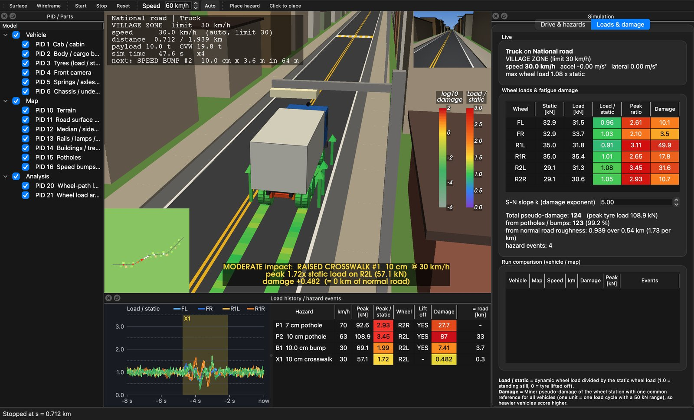
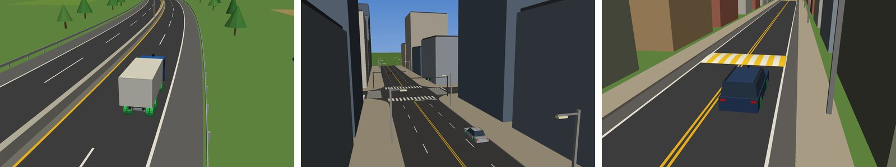
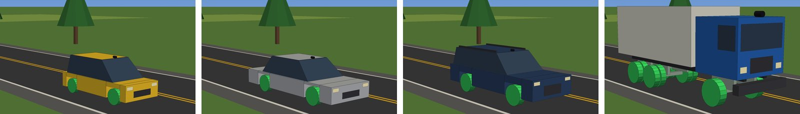
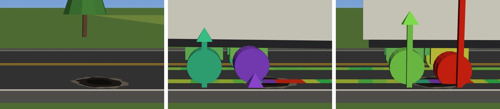
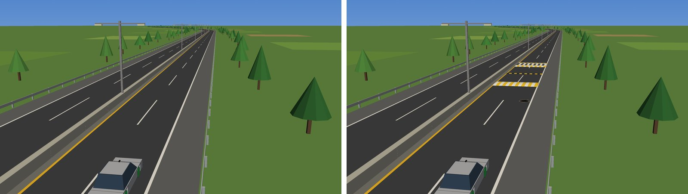

# Drive-vehicle

포트홀과 과속방지턱을 지날 때 **바퀴마다 걸리는 하중과 쌓이는 손상**을 3D로 보여 주는 차량 시뮬레이터입니다.
C++17, Qt 6, VTK 9로 만들었습니다.



## 주요 기능

- **맵 3종**: 고속도로, 시내 주행, 일반 국도
- **차종 4종**: 경차, 세단, SUV, 트럭. 무게가 달라 같은 장애물에서도 하중과 손상이 다릅니다.
- **위험 요소 설치**: 포트홀과 과속방지턱 7종을 차 앞이나 클릭한 위치에 놓습니다.
- **속도 조절**: 구간 제한속도를 따르거나 5~130 km/h로 고정합니다. 0.25배속부터 8배속까지 볼 수 있습니다.
- **하중 시각화**: 타이어 색, 하중 화살표, 바퀴 궤적의 하중 지도, 실시간 그래프
- **기록과 비교**: 위험 요소별 최대 하중과 손상, 주행별 비교 표
- **기존 예제 기능 유지**: PID 트리, 부품 선택, Surface/Wireframe, 전방 카메라

## 화면

맵: 고속도로, 시내 주행, 일반 국도



차종: 경차, 세단, SUV, 트럭 (같은 카메라 위치)



깊이 10 cm 포트홀을 60 km/h로 지나는 트럭의 뒷바퀴. 왼쪽부터 진입 전, 바퀴가 뜬 순간(보라, 하중 0), 모서리에 부딪힌 순간(빨강, 정지 하중의 2.84배)



위험 요소 설치 전과 후. 가까운 쪽부터 포트홀, 과속방지턱, 고무 방지턱, 고원식 횡단보도



## 빌드와 실행

### 필요한 것

- CMake 3.20 이상 (프리셋을 쓰려면 3.25 이상), Ninja, C++17 컴파일러
- Qt 6 (Widgets, OpenGL)
- Qt 지원을 켜고 빌드한 VTK 9 (`-DVTK_GROUP_ENABLE_Qt=YES -DVTK_QT_VERSION=6`)

확인한 환경은 macOS 26.3 (Apple Silicon), Apple clang 17, VTK 9.6.1, Qt 6.12.0, CMake 4.4.5입니다.

### macOS

`/path/to/vtk-install`을 VTK 설치 경로로 바꿔 실행합니다. Qt는 Homebrew로 설치한 경우입니다.

```bash
git clone https://github.com/HYUJUNKIM/Autocomputergraphics_final_exam.git
cd Autocomputergraphics_final_exam

cmake -S . -B out/build/macos -G Ninja \
  -DCMAKE_BUILD_TYPE=RelWithDebInfo \
  -DCMAKE_PREFIX_PATH="/path/to/vtk-install;$(brew --prefix qt)"
cmake --build out/build/macos
./out/build/macos/Drive-vehicle
```

### Windows

`CMakePresets.json`은 Qt가 `D:/dev/Qt/6.10.2/msvc2022_64`, VTK가 `D:/dev/VTK/vtk-install`에 있다고 가정합니다.
경로가 다르면 `CMakePresets.json`의 `CMAKE_PREFIX_PATH`와 `PATH`를 고치세요.
*x64 Native Tools Command Prompt for VS 2022*에서 실행합니다.

```bat
cmake --preset x64-relwithdebinfo
cmake --build --preset build-relwithdebinfo
set PATH=D:\dev\VTK\vtk-install\bin;D:\dev\Qt\6.10.2\msvc2022_64\bin;%PATH%
out\build\x64-relwithdebinfo\Drive-vehicle.exe
```

> 현재 버전은 macOS에서만 빌드하고 실행해 보았습니다. Windows 절차는 프리셋 기준이며 아직 검증하지 않았습니다.

## 사용법

1. 메뉴바 **Road**에서 맵, **Vehicle**에서 차종을 고릅니다.
2. 필요하면 **Hazards** 메뉴나 오른쪽 **Drive & hazards** 탭에서 위험 요소를 놓습니다.
3. 툴바의 **Start**를 누릅니다.
4. **Loads & damage** 탭과 아래쪽 그래프, 이벤트 표에서 결과를 봅니다.

- **Auto**는 제한속도와 커브에 맞춰 달립니다. 방지턱이나 포트홀 앞에서 따로 감속하지는 않습니다.
- 속도를 직접 바꾸면 Auto가 꺼집니다. 급커브와 코스 끝에서는 고정 속도에서도 감속합니다.
- 서스펜션 움직임은 보기 쉽게 기본 3배로 과장해 그립니다. 계산과 전방 카메라에는 적용되지 않습니다.
- 닫은 패널은 툴바를 우클릭해 다시 켤 수 있습니다.

### 단축키

| 기능 | macOS | Windows |
|---|---|---|
| 맵 선택 (고속도로 / 시내 / 국도) | ⌘1 / ⌘2 / ⌘3 | Ctrl+1 / 2 / 3 |
| 차종 선택 (경차 / 세단 / SUV / 트럭) | ⇧⌘1 ~ ⇧⌘4 | Ctrl+Shift+1 ~ 4 |
| 차 앞에 위험 요소 놓기 | ⌘P | Ctrl+P |
| 도로를 클릭해 놓기 켜기/끄기 | ⌘K | Ctrl+K |
| 설치 취소 | ⌘Z | Ctrl+Z |
| 속도 5 km/h 올리기 / 내리기 | ⌘↑ / ⌘↓ | Ctrl+↑ / Ctrl+↓ |
| 카메라 (추적 / 바퀴 / 위 / 앞 / 전체) | F1 ~ F5 | F1 ~ F5 |

macOS에서 ⇧⌘3과 ⇧⌘4는 시스템 스크린샷 단축키와 겹치므로 SUV와 트럭은 메뉴에서 고르세요.

### 명령줄 옵션

```bash
./out/build/macos/Drive-vehicle --map city --vehicle sedan --speed 40 --run
```

| 옵션 | 값 |
|---|---|
| `--map` | `highway`, `city`, `national` |
| `--vehicle` | `compact`, `sedan`, `suv`, `truck` |
| `--start`, `--start-at` | 시작 구간 번호, 시작 위치(m) |
| `--speed` | 고정 속도(km/h). 없으면 Auto |
| `--time-scale` | `0.25`, `0.5`, `1`, `2`, `4`, `8` |
| `--view` | `chase`, `wheels`, `top`, `front`, `map` |
| `--hazard`, `--place-ahead` | 위험 요소 번호(0~6), 실행 후 설치 시점(ms) |
| `--run` | 바로 주행 시작 |
| `--screenshot`, `--screenshot-after`, `--quit` | 저장할 파일, 캡처 시점(ms), 캡처 후 종료 |

## 맵, 차종, 위험 요소

| 맵 | 길이 | 설정 제한속도 (km/h) | 기본 위험 요소 |
|---|---|---|---|
| 고속도로 | 3.04 km | 100 (트럭 90) | 포트홀 7 |
| 시내 주행 | 1.30 km (한 바퀴) | 50, 어린이보호구역 30 | 포트홀 5, 방지턱 3, 고원식 횡단보도 2 |
| 일반 국도 | 1.94 km | 70, 마을 30 | 포트홀 5, 방지턱 3, 고원식 횡단보도 1 |

| 차종 | 총중량 (기본 적재) | 축 / 바퀴 | 앞바퀴 정지 하중 | 적재량 조절 |
|---|---|---|---|---|
| 경차 | 1.12 t | 2 / 4 | 3.1 kN | 0~400 kg |
| 세단 | 1.73 t | 2 / 4 | 4.8 kN | 0~500 kg |
| SUV | 2.15 t | 2 / 4 | 5.6 kN | 0~600 kg |
| 트럭 | 19.76 t | 3 / 6 | 32.9 kN | 0~16 t |

| 번호 | 위험 요소 | 크기 |
|---|---|---|
| 0 / 1 / 2 | 포트홀 소 / 중 / 대 | 깊이 4 / 7 / 10 cm |
| 3 | 과속방지턱 | 높이 10 cm, 길이 3.6 m |
| 4 | 짧은 과속방지턱 | 높이 7.5 cm, 길이 2.0 m |
| 5 | 고무 방지턱 | 높이 5 cm, 길이 0.9 m |
| 6 | 고원식 횡단보도 | 높이 10 cm, 경사 2 m + 윗면 4 m + 경사 2 m |

포트홀은 오른쪽 바퀴, 왼쪽 바퀴, 양쪽, 클릭한 위치 중에서 고르고, 방지턱은 차도 전체에 걸쳐 놓입니다.

## 계산 방법

0.5 ms 간격으로 다음을 반복하고, 프레임마다 형상과 색을 갱신합니다.

1. **노면 높이**: ISO 8608 형식의 무작위 거칠기에 위험 요소 모양을 더합니다. 타이어가 모서리를 감싸는 효과는 바퀴를 원으로 보고 접지 길이로 평균해 근사합니다.
2. **차량 운동**: 차체(상하, 앞뒤 기울기, 좌우 기울기)와 바퀴별 상하 운동을 계산합니다. 승용차 7자유도, 트럭 9자유도입니다. 타이어는 밀기만 하므로 바퀴가 뜨면 하중이 0이 됩니다. 가감속과 코너의 하중 이동도 포함합니다.
3. **하중비**: 현재 바퀴 하중 / 정지 하중. 1은 정지 상태, 0은 바퀴가 뜬 상태입니다.
4. **손상 지표**: 하중이 오르내린 반주기의 크기 ΔF를 세어 더합니다. 기준 50 kN은 모든 차에 같고, 지수 k는 기본 5이며 화면에서 3~12로 바꿀 수 있습니다.

```text
D = Σ 0.5 × (ΔF / 50 kN)^k
```

## 결과 예시

깊이 10 cm 포트홀(오른쪽 바퀴) 하나를 60 km/h로 지날 때입니다.

| | 경차 | 세단 | SUV | 트럭 |
|---|---|---|---|---|
| 최대 타이어 하중 | 15.6 kN | 21.8 kN | 23.9 kN | 122.2 kN |
| 정지 하중 대비 | 5.55배 | 5.01배 | 4.46배 | 4.19배 |
| 손상 지표 | 0.0042 | 0.023 | 0.042 | 176 |

- 절대 하중은 무거운 차가 크고, 정지 하중 대비 배율은 가벼운 차가 큽니다.
- 과속방지턱은 빠를수록 하중이 커집니다. 포트홀은 세단 50 km/h, 트럭 40 km/h에서 가장 컸습니다(10~80 km/h를 10 km/h 간격으로 계산).

## 코드 구조

| 파일 | 역할 |
|---|---|
| `main.cpp` | 실행과 명령줄 옵션 |
| `MainWindow` | 메뉴와 패널, 주행 루프, 카메라, 클릭 설치, 3D 갱신 |
| `RoadNetwork` | 맵, 구간, 위험 요소, 노면 높이, 맵 메쉬 |
| `VehicleModel` | 차종별 제원, 차체와 바퀴의 운동 |
| `LoadAnalyzer` | 하중 반복 세기, 손상 누적, 위험 요소별 기록 |
| `PidActorManager` | PID별 형상, 색, 선택, 표시 |
| `MeshBuilder` | VTK 메쉬 생성 |
| `LoadPlotWidget` | 하중 그래프 |

`RoadNetwork`, `VehicleModel`, `LoadAnalyzer`는 Qt에 의존하지 않아 화면 없이도 계산을 돌려 볼 수 있습니다.

## 한계

- 실제 차량의 측정값과 비교하지 않았습니다. 절대값보다 조건 사이의 비교에 사용하세요.
- 차량 제원은 차급별 대표값을 가정한 것이며 특정 차량의 값이 아닙니다.
- 손상 지표는 부품 강도를 반영하지 않으므로 수명을 뜻하지 않습니다. 반주기를 차례로 세는 간단한 방식이며 레인플로 방법이 아닙니다.
- 타이어는 단순화한 모델이고, 노면 거칠기는 난수로 만듭니다.
- 제한속도는 시뮬레이션 설정값으로 법정 기준과 다를 수 있습니다.

## 출처와 자료

- 수업 저장소의 [vtk/drive-vehicle](https://github.com/kevindskim/Autocomputergraphics2026) 예제를 바탕으로 확장했습니다. 첫 커밋이 원본 예제입니다.
- 발표 자료: [docs/drive-vehicle-presentation.pptx](docs/drive-vehicle-presentation.pptx)
